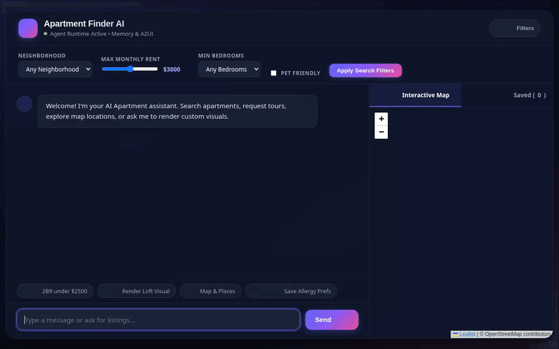

# Apartment Finder Agent 🏢

An intelligent conversational AI assistant built with Google Agent Development Kit (ADK) that helps users search, evaluate, compare, and visualize apartment rental listings.



---

## 🌟 Key Features & Capabilities

Based on the codebase in `app/`, the agent implements the following features:

- **Apartment Search & Filtering**: Queries Firestore database listings (`apartments` collection) by max rent, neighborhood, bedrooms, and pet policies (`search_apartments`).
- **Listing Details & Management**: Fetches full listing specifications (`get_apartment_details`) and creates new listings directly in Firestore (`add_apartment_listing`).
- **In-Person & Virtual Tour Booking**: Records tour requests in Firestore (`schedule_tour_request`).
- **Long-Term Memory Persistence**: Automatically remembers user budget limits, preferred neighborhoods, pet requirements, and allergies across sessions via **Vertex AI Memory Bank**.
- **Visual Image Generation**: Generates custom apartment interior and layout previews using `gemini-3.1-flash-lite-image` in the global region (`generate_apartment_image`), saving artifacts and uploading to Google Cloud Storage.
- **Video Walkthrough Generation**: Generates video walkthrough tours using Google's Omni model (`gemini-omni-flash-preview`) in the global region (`generate_apartment_video`), saving artifacts and uploading to Google Cloud Storage.
- **Location & Geocoding Services**: Geocodes street addresses (`geocode_address`), looks up ZIP code boundaries (`lookup_zipcode_location`), and finds nearby points of interest via Google Maps API (`find_nearby_places`).
- **Rich A2UI Card Surfaces**: Renders clean, structured display cards and comparison tables using A2UI v0.8 (`A2uiSchemaManager`).
- **Financial & Rent Calculations**: Computes rent-to-income ratios, lease totals, and estimated monthly utility costs using `AgentEngineSandboxCodeExecutor`.

---

## 🛠️ Google Cloud Services & Integrations

- **Vertex AI Memory Bank**: Cross-session long-term memory store.
- **Google Cloud Firestore**: NoSQL database for listing data and tour request bookings.
- **Google Cloud Storage**: Public bucket hosting generated images and video walkthroughs.
- **Vertex AI / Gemini Models**:
  - `gemini-flash-latest` for core reasoning & conversation.
  - `gemini-3.1-flash-lite-image` for image generation.
  - `gemini-omni-flash-preview` for video generation.
- **Google Maps API**: Geocoding and nearby location discovery.

---

## 🚀 Setup & Local Execution Instructions

### Prerequisites
- Python 3.12 or 3.13
- `uv` package manager installed
- Authenticated `gcloud` SDK with ADC (`gcloud auth application-default login`)

### Running the Agent Locally

1. **Install Dependencies**:
   ```bash
   uv sync
   ```

2. **Configure Environment Variables**:
   Create a `.env` file in the project directory:
   ```env
   GOOGLE_GENAI_USE_VERTEXAI=true
   GOOGLE_CLOUD_LOCATION=us-east1
   GOOGLE_MAPS_API_KEY=your_google_maps_api_key
   ```

3. **Start the FastAPI Proxy & Chat UI**:
   ```bash
   cd frontend
   uv run python3 main.py
   ```

4. **Access the Chat Interface**:
   Open your local browser to the port printed by the server (default: port 8080).

---

## 🚢 Deployment Instructions

To deploy the agent to Google Cloud Agent Platform / Agent Runtime:

```bash
uv run agents-cli deploy \
  --project <YOUR_GCP_PROJECT_ID> \
  --no-confirm-project \
  --update-env-vars GOOGLE_MAPS_API_KEY=<YOUR_GOOGLE_MAPS_API_KEY>
```
